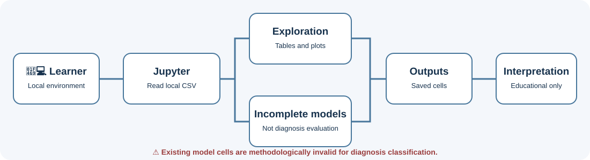
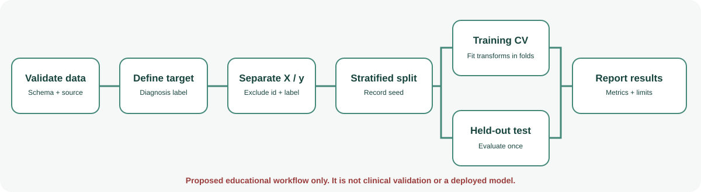

<div align="center">

# 🧬 Breast Cancer Detection & Data Analysis

### An educational machine-learning repository for exploring the Wisconsin Diagnostic dataset

[](https://www.python.org/)
[](https://jupyter.org/)
[](https://scikit-learn.org/)
[](LICENSE)
[](docs/project-status.md)
[](docs/safety-and-responsible-use.md)

**[📘 Documentation](docs/README.md) · [🚀 Getting Started](docs/getting-started.md) · [🤝 Contributing](CONTRIBUTING.md) · [🛡️ Security](SECURITY.md)**

</div>

> [!CAUTION]
> **This repository is an educational data-analysis exercise, not a medical device, validated diagnostic model, screening system, or source of medical advice. Do not use its notebook, code, plots, or outputs to diagnose, rule out cancer, make treatment decisions, or guide patient care.**
>
> The existing notebook's model examples are methodologically invalid for diagnosis classification. One section copies known labels into predictions, producing a meaningless 1.0 score. Another split predicts a measurement column while leaving diagnosis among the inputs. No trustworthy cancer-classification performance result is established.

---

## 🌟 Project at a glance

This project explores a tabular dataset containing measurements computed from digitized images of fine needle aspirates of breast masses. It is intended to help learners practice Python, pandas, visualization, notebook workflows, and responsible machine-learning methodology.

| Attribute | Current repository facts |
|---|---|
| Project type | Local Python / Jupyter notebook |
| Main notebook | `Breast_Cancer.ipynb` |
| Dataset file | `breast-cancer.csv` |
| Dataset dimensions | 569 rows × 32 columns |
| Columns | 1 identifier, 1 diagnosis label, 30 numeric measurements |
| Diagnosis labels | `M` = malignant, `B` = benign |
| Label distribution | 212 malignant, 357 benign |
| Runtime | Python 3.10+ recommended |
| Application/API/database | Not implemented |
| Clinical validation | Not performed |

## 🎯 Goals and non-goals

### ✅ Educational goals
- Load and inspect a real-world tabular dataset.
- Understand feature families, labels, identifiers, and data types.
- Explore distributions, relationships, and class balance.
- Learn why leakage, invalid splits, and misleading metrics matter.
- Build a reproducible, documented analysis workflow.

### 🚫 Explicit non-goals
- Diagnosing an individual or estimating a person's cancer risk.
- Replacing a clinician, pathology workflow, or validated diagnostic instrument.
- Providing treatment, screening, triage, or reassurance.
- Claiming clinical accuracy, regulatory approval, or real-world generalizability.
- Presenting the current notebook as a finished classifier.

## 🧭 Table of contents

- [Project at a glance](#-project-at-a-glance)
- [Goals and non-goals](#-goals-and-non-goals)
- [How the repository works](#-how-the-repository-works)
- [Dataset overview](#-dataset-overview)
- [Repository structure](#-repository-structure)
- [Quick start](#-quick-start)
- [Run and inspect the notebook](#-run-and-inspect-the-notebook)
- [Modeling integrity and known defects](#-modeling-integrity-and-known-defects)
- [Responsible use and limitations](#-responsible-use-and-limitations)
- [Validation and quality checks](#-validation-and-quality-checks)
- [Documentation map](#-documentation-map)
- [Contributing](#-contributing)
- [License and dataset attribution](#-license-and-dataset-attribution)
- [Maintainer](#-maintainer)

## 🔄 How the repository works

### Current notebook workflow



1. The notebook reads the local CSV using pandas.
2. It inspects dimensions, columns, types, nulls, duplicates, and descriptive statistics.
3. It maps diagnosis labels and explores selected features using plots.
4. It runs incomplete model demonstrations. These must not be interpreted as a diagnosis classifier.

### Recommended future experiment workflow



The diagram describes a proposed methodology, not functionality already implemented. It separates the target, excludes the identifier, keeps preprocessing inside training folds, and reserves held-out data for final evaluation.

## 📊 Dataset overview

The CSV currently contains 569 observations and 32 columns. The diagnosis labels are:

| Label | Meaning | Count |
|---|---|---:|
| `B` | Benign | 357 |
| `M` | Malignant | 212 |
| **Total** | | **569** |

The 30 numeric measurements form ten feature families: radius, texture, perimeter, area, smoothness, compactness, concavity, concave points, symmetry, and fractal dimension. Each family has mean, standard error (`_se`), and worst-value variants.

The schema and row count match the UCI Breast Cancer Wisconsin (Diagnostic) dataset. The download history of this exact CSV copy is not recorded in this repository, so its precise provenance is **not verified**. Read [dataset provenance and licensing](docs/dataset-provenance.md) before redistributing it.

## 🗂️ Repository structure

```text
Breast_Cancer_Detection/
├── .github/
│   ├── ISSUE_TEMPLATE/             # Structured bug, feature, docs and security reports
│   ├── PULL_REQUEST_TEMPLATE.md    # Review and evidence checklist
│   ├── DISCUSSION_TEMPLATE/        # Community discussion forms
│   ├── dependabot.yml              # Dependency update configuration
│   └── workflows/                  # CI, docs checks and dependency audit
├── docs/
│   ├── assets/                     # Original SVG flow diagrams
│   ├── templates/                  # ADR, experiment, dataset and review templates
│   ├── architecture.md
│   ├── data-dictionary.md
│   ├── dataset-provenance.md
│   ├── modeling-methodology.md
│   ├── evaluation-plan.md
│   ├── safety-and-responsible-use.md
│   ├── privacy.md
│   ├── threat-model.md
│   ├── testing.md
│   └── ...                         # Full documentation index
├── scripts/
│   ├── validate_dataset.py         # CSV schema and integrity checks
│   └── validate_docs.py            # Local Markdown link and fence checks
├── tests/
│   └── test_dataset_contract.py    # Dataset contract tests
├── Breast_Cancer.ipynb             # Existing exploratory notebook
├── breast-cancer.csv               # Existing dataset snapshot
├── CODE_OF_CONDUCT.md
├── CONTRIBUTING.md
├── LICENSE
├── LICENSE-DATA.md
├── README.md
├── SECURITY.md
├── SUPPORT.md
├── CHANGELOG.md
├── CITATION.cff
├── requirements.txt
└── pyproject.toml
```

This is a guide to the intended repository layout. See [Project structure](docs/project-structure.md) for the role and boundaries of each component.

## 🚀 Quick start

### 1. Clone the repository

```bash
git clone https://github.com/Brajesh31/Breast_Cancer_Detection.git
cd Breast_Cancer_Detection
```

### 2. Create a virtual environment

**Windows PowerShell**
```powershell
python -m venv .venv
.\.venv\Scripts\Activate.ps1
```

**macOS / Linux**
```bash
python3 -m venv .venv
source .venv/bin/activate
```

### 3. Install dependencies

```bash
python -m pip install --upgrade pip
python -m pip install -r requirements.txt
```

### 4. Launch Jupyter

```bash
jupyter notebook
```

Open `Breast_Cancer.ipynb`. Start Jupyter from the repository root because the notebook reads `breast-cancer.csv` using a relative path.

See [Installation](docs/installation.md), [Getting started](docs/getting-started.md), and [Troubleshooting](docs/troubleshooting.md) for environment-specific guidance.

## 📓 Run and inspect the notebook

- Use **Kernel → Restart Kernel and Run All Cells** after making changes.
- Inspect the notebook markdown and code together. Saved outputs may be stale.
- Check that each plot has a title, readable axes, and an explanation.
- Review warnings rather than globally suppressing them.
- Do not interpret the current model output as a diagnostic result.

The notebook is an exploratory artifact. A clean, successful notebook execution has not been asserted by this documentation update.

## ⚠️ Modeling integrity and known defects

The current notebook contains material methodological problems:

1. **Wrong target:** the train/test split uses the last feature, `fractal_dimension_worst`, as the target rather than `diagnosis`.
2. **Target leakage:** diagnosis remains in the input columns for that split.
3. **Tautological toy score:** the section named “Logistic Regression” uses a tiny synthetic table and assigns predictions directly from known labels. The reported 1.0 score is not learned performance.
4. **Unrelated regression task:** the linear-regression example does not implement diagnosis classification.
5. **State reuse:** the notebook reuses the variable name `data` for different object types.
6. **Compatibility:** the notebook's use of `mean_squared_error(..., squared=False)` is incompatible with scikit-learn 1.6 and later.

A corrected educational experiment should define `y = diagnosis`, remove both `id` and `diagnosis` from `X`, split data with stratification, fit preprocessing only on training folds, and report class-specific metrics. See [Known issues](docs/known-issues.md) and [Modeling methodology](docs/modeling-methodology.md).

## 🛡️ Responsible use and limitations

- Dataset benchmarks do not establish clinical utility.
- This dataset does not demonstrate performance across hospitals, scanners, populations, or current clinical workflows.
- A model can perform well on a public benchmark and still fail on new data.
- False negatives and false positives have serious consequences in medical contexts.
- Any patient-facing or clinical use would require separate clinical, legal, regulatory, privacy, security, and ethics review.

Read [Safety and responsible use](docs/safety-and-responsible-use.md) before using or sharing project outputs.

## 🧪 Validation and quality checks

After installing the dependencies and pytest, run:

```bash
python scripts/validate_dataset.py
python scripts/validate_docs.py
python -m pytest -q
```

These checks cover the documented static CSV contract and documentation links. They do **not** validate model performance, notebook execution, dataset representativeness, or clinical safety. Report the exact commands and outcomes you actually ran.

## 📚 Documentation map

| Guide | What it covers |
|---|---|
| [Documentation hub](docs/README.md) | Full index and reading paths |
| [Architecture](docs/architecture.md) | Current system boundary and notebook flow |
| [Project structure](docs/project-structure.md) | Directory and file responsibilities |
| [Data dictionary](docs/data-dictionary.md) | Column groups and label semantics |
| [Dataset provenance](docs/dataset-provenance.md) | Source uncertainty, attribution and licensing |
| [Modeling methodology](docs/modeling-methodology.md) | Leakage-safe experiment design |
| [Evaluation plan](docs/evaluation-plan.md) | Metrics, splits and reporting |
| [Testing](docs/testing.md) | Checks and limitations |
| [Privacy](docs/privacy.md) | Data handling boundaries |
| [Threat model](docs/threat-model.md) | Notebook, dependency and workflow risks |
| [Security policy](SECURITY.md) | Private vulnerability reporting |
| [Contributing](CONTRIBUTING.md) | Contribution workflow and standards |
| [Code of Conduct](CODE_OF_CONDUCT.md) | Community expectations |
| [Changelog](CHANGELOG.md) | Notable project changes |
| [Roadmap](ROADMAP.md) | Proposed work, not commitments |

## 🤝 Contributing

Contributions that improve reproducibility, documentation, data provenance, notebook correctness, and safe educational use are welcome. Read [CONTRIBUTING.md](CONTRIBUTING.md), follow the [Code of Conduct](CODE_OF_CONDUCT.md), and use the pull request template. Do not add private health data or unsupported medical claims.

## 📄 License and dataset attribution

Original project code and documentation are licensed under the MIT License. The CSV is a separate dataset artifact and may be subject to separate terms. The repository's exact CSV acquisition provenance has not been established. See [LICENSE](LICENSE), [LICENSE-DATA.md](LICENSE-DATA.md), and [Dataset provenance](docs/dataset-provenance.md).

Suggested citation for the matching UCI dataset: Wolberg, W., Mangasarian, O., Street, N., & Street, W. (1993). *Breast Cancer Wisconsin (Diagnostic)* [Dataset]. UCI Machine Learning Repository. https://doi.org/10.24432/C5DW2B.

## 👨‍💻 Maintainer

**Brajesh Kumar** · [@brajesh31](https://github.com/brajesh31)

---

<div align="center">

⭐ If this educational repository helps you learn, consider starring it and sharing constructive feedback.

**Learn carefully. Validate honestly. Never confuse a benchmark with clinical evidence.**

</div>

Last updated: 2026-11-16 21:31 UTC
