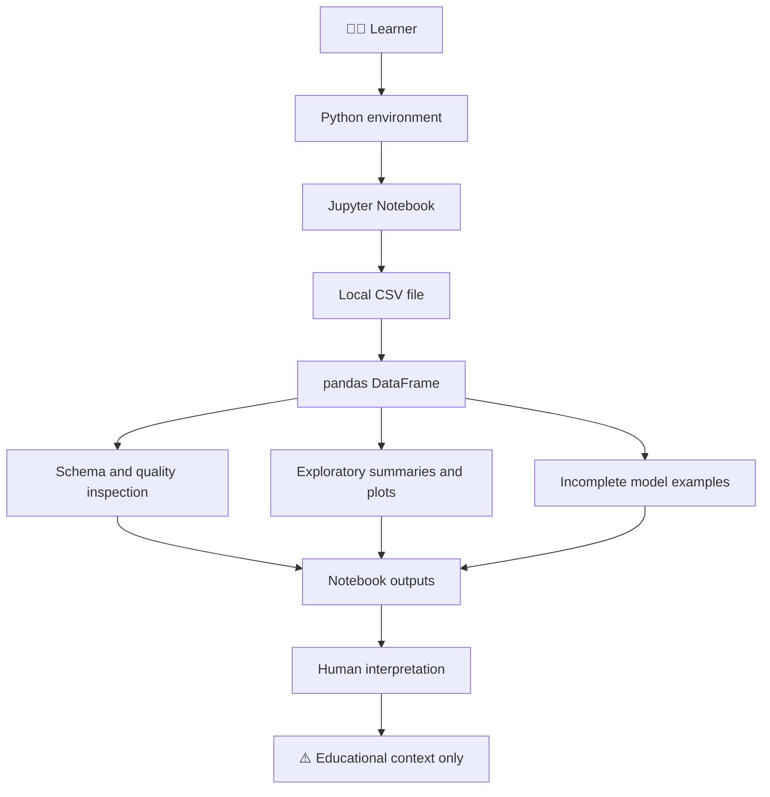
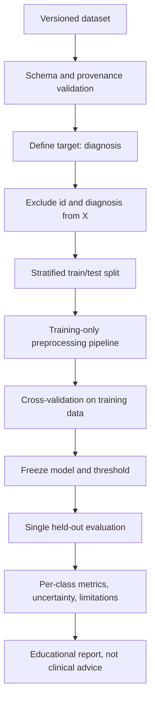

# 🏛️ Architecture and System Boundaries

## 1. Current architecture

This repository is a local notebook workflow. It has no deployed service, user-facing web application, database, API, background job, authentication, or hosted inference model.

## 2. Component responsibilities

| Component | Responsibility | Boundary |
|---|---|---|
| Notebook | Executes analysis cells and renders output | Local kernel only |
| CSV | Supplies static observations and labels | No live data source |
| pandas | Loads and manipulates the table | In-memory DataFrame |
| NumPy | Numerical operations | Notebook runtime |
| Matplotlib / Seaborn | Visual exploration | Static notebook plots |
| scikit-learn | Existing preprocessing and example estimators | Current model examples are not valid diagnosis evaluation |
| GitHub workflows | Repository checks | No model-serving or clinical assurance |

## 3. Current data path

The notebook loads the CSV by a relative path. It inspects the DataFrame, transforms diagnosis labels, and renders summaries and plots. The later modeling code does not correctly define diagnosis as the target. See [Known issues](known-issues.md).

## 4. Proposed safe experiment boundary

This is a recommended future workflow, not current implementation.

## 5. Trust boundaries and execution

Notebook cells execute Python with the local user's permissions. Running an untrusted notebook can read or modify accessible files and may access network resources if code requests it. Review diffs, use an isolated environment, and avoid running untrusted notebooks where sensitive files are accessible.

## 6. Architecture decisions

- Keep the project notebook-first while its purpose remains educational.
- Do not introduce a backend, database, API, or UI without an actual requirement.
- Keep dataset licensing distinct from the project code license.
- Do not report model metrics until a valid experiment exists.
- Treat clinical use as out of scope.

See [Threat model](threat-model.md), [Data flow](data-flow.md), and [Project structure](project-structure.md).
