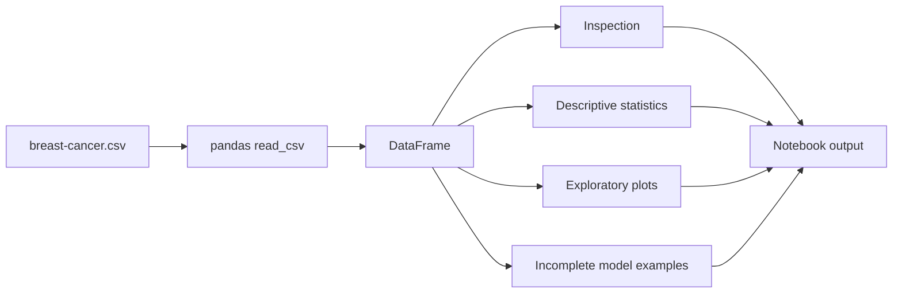
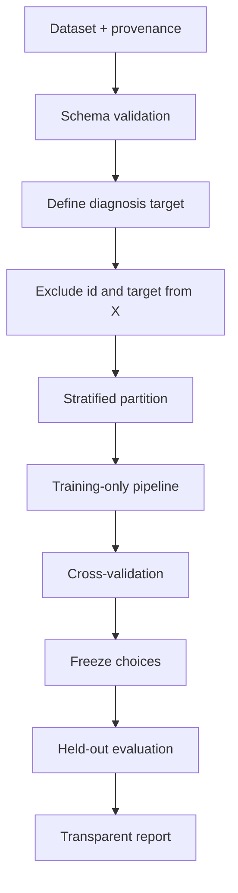

# 🔄 Data Flow

## Current implementation

The current modeling branch is not a valid diagnosis classification pipeline. See [Modeling methodology](modeling-methodology.md).

## Recommended future analysis

## Data boundaries

The notebook reads a local static file. There is no network ingestion, user upload endpoint, database, or patient record system in the current repository.
