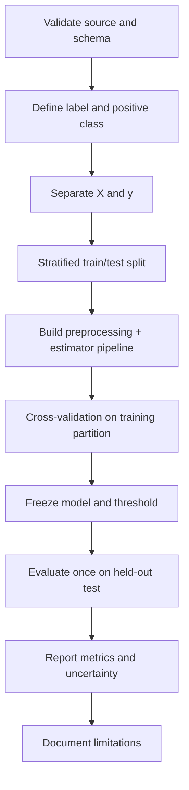

# 🧠 Modeling Methodology and Leakage Prevention

## 1. Current status

The current notebook does not implement a valid diagnosis classifier. This document describes the defects and a recommended educational design. It does not report a trained model or performance result.

## 2. Confirmed defects in the current notebook

1. The existing split uses the final column, `fractal_dimension_worst`, as the target.
2. The `diagnosis` column remains among the inputs.
3. The “Logistic Regression” section uses an eight-row synthetic example and copies known labels into predictions.
4. The resulting 1.0 score is tautological.
5. The linear regression section is not a diagnosis classifier.
6. The notebook reuses the name `data` for unrelated object types.

Do not quote the toy score as model accuracy.

## 3. Define the task correctly

For a future educational binary classification experiment:
- Target: `diagnosis`.
- Identifier excluded: `id`.
- Predictors: the 30 numeric measurement columns.
- Label encoding: define and document which class is positive before calculating metrics.

A column-separation example:

```python
target_column = "diagnosis"
X = frame.drop(columns=["id", target_column])
y = frame[target_column]
```

This snippet is not a full estimator, training pipeline, or validation protocol.

## 4. Prevent data leakage

Data leakage occurs when information unavailable at prediction time, or information derived from the target, influences model fitting or evaluation.

Required controls:
- Remove the target from the feature matrix.
- Exclude record identifiers unless a justified non-leaking use is established.
- Split before fitting scalers, imputers, feature selectors, or other learned transforms.
- Place learned transformations inside a scikit-learn Pipeline.
- Fit transformations separately inside each cross-validation training fold.
- Do not choose thresholds or hyperparameters using the final test set.
- Avoid duplicate or near-duplicate records across train and test partitions.

## 5. Recommended experiment sequence



## 6. Baselines and model selection

Start with a simple, interpretable baseline. Compare more complex models only when there is a clear question and a controlled validation design. Keep all model selection within training data. Record the estimator, hyperparameters, random seed, split strategy, preprocessing, and package versions.

## 7. Reporting

At minimum, a future report should include:
- Sample counts and class proportions per partition.
- Explicit positive-class definition.
- Confusion matrix.
- Precision, recall/sensitivity, and F1 by class.
- Specificity where defined and clinically meaningful.
- ROC-AUC or PR-AUC only with appropriate interpretation.
- Threshold selection procedure.
- Confidence intervals or uncertainty discussion.
- Error analysis and known limitations.

Accuracy alone is insufficient, especially when class prevalence is uneven.

## 8. Safety boundary

Even a correct benchmark evaluation does not establish clinical validity. No output from this project should be used for screening, diagnosis, treatment, triage, or patient care.
