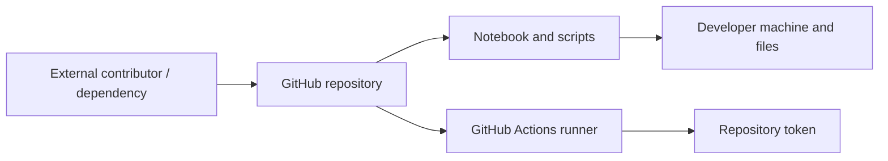

# 🛡️ Lightweight Threat Model

## Scope

This is a lightweight engineering review of the local notebook repository and its GitHub automation. It is not a formal security audit, clinical risk assessment, or certification.

## Assets

- Repository integrity and history.
- Local developer files accessible to the notebook kernel.
- Static dataset and notebook outputs.
- GitHub repository permissions and workflow tokens.
- Contributor credentials and any accidentally introduced sensitive data.

## Trust boundaries

## Threat register

| Threat | Potential impact | Mitigation |
|---|---|---|
| Malicious notebook cell | Local code execution or data access | Review diffs; isolated environment |
| Malformed CSV | Crashes or misleading analysis | Schema and integrity checks |
| Compromised dependency | Arbitrary code execution | Dependency review and audit |
| Over-permissioned workflow | Unwanted repository changes | Least privilege |
| Secret committed to notebook | Credential compromise | Secret scanning, rotation, history cleanup |
| Private health data committed | Privacy and legal harm | Data review; prohibit sensitive data |
| Misleading model metric | Unsafe interpretation | Correct methodology; explicit disclaimer |
| Dataset license misunderstood | Redistribution risk | Verify source and terms |

## Residual limitations

No continuous security monitoring, formal penetration test, clinical risk assessment, or compliance audit is performed. This document should be revisited when architecture or data sources change.
